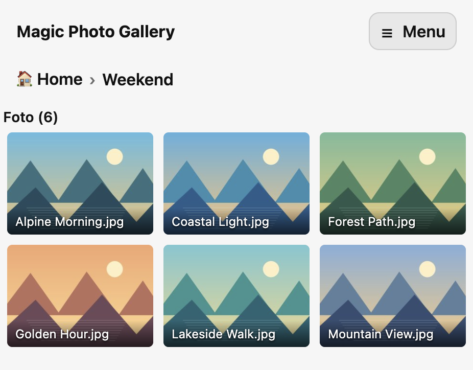

# Magic Photo Gallery

This is an all-in-one image gallery which you simply put inside your images directory and open with a browser.
It requires and HTTPD server with PHP support.

Just simply use my [docker image](https://github.com/napalmz/httpd-base), as shown [here](#Deployment).

## Screenshots



## Languages

The UI is translated into 32 European languages (en, it, fr, de, es, pt, nl, pl, ro, cs, sk, sl, hr, bg, el, hu, fi, sv, da, no, is, et, lv, lt, ga, mt, ca, uk, ru, sr, sq, mk).

- By default the language follows the browser (`Accept-Language`), falling back to English.
- The menu has a language selector; the choice is saved in `.Magic-Photo-Gallery/.config.json` (`"language": "auto"` or a code such as `"de"`).
- The saved language is global for all visitors. With `auth_mode` 1/2 only logged-in users can change it.

## Deployment

First, move to your image directory and download the app:

```
wget -O index.php https://raw.githubusercontent.com/napalmz/Magic-Photo-Gallery/main/index.php
```

Then, spinup a docker container (using compose):
```compose
services:
  httpd-server-main:
    image: napalmzrpi/httpd-base:latest
    container_name: httpd-server-main
    environment:
      - TZ=Europe/Rome
    volumes:
      - "/my/app/directory/config:/var/www/site"        # Store PHP app and configurations
      - "/my/app/directory/log:/var/log/apache2"        # Store APACHE/PHP logs
      - "/my/photo/directory1:/var/www/site/Photo 1:ro" # Safely store pictures, it's READ ONLY
      - "/my/photo/directory2:/var/www/site/Photo 2:ro" # Safely store pictures, it's READ ONLY
      - "/my/photo/directory3:/var/www/site/Photo 3:ro" # Safely store pictures, it's READ ONLY
    ports:
      - 80:80
    restart: always
```
